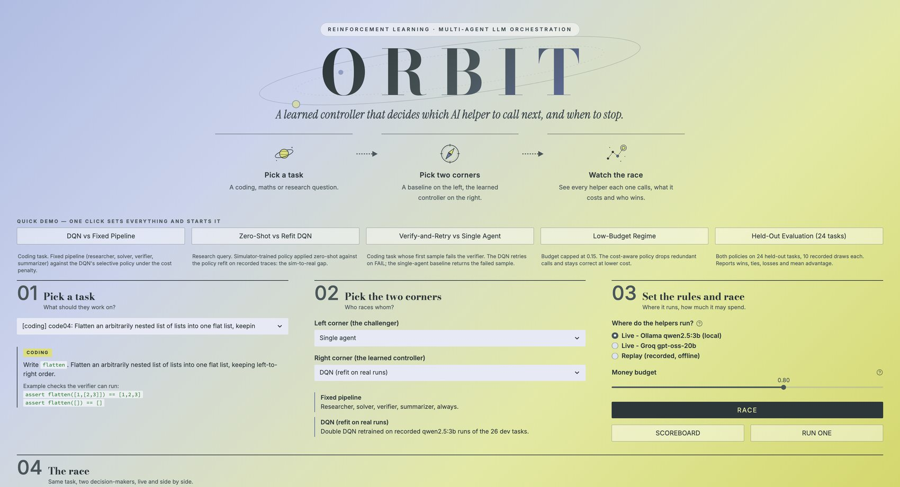
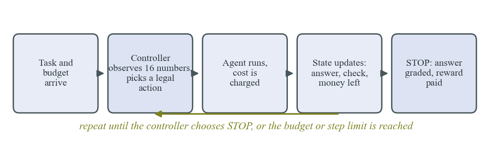
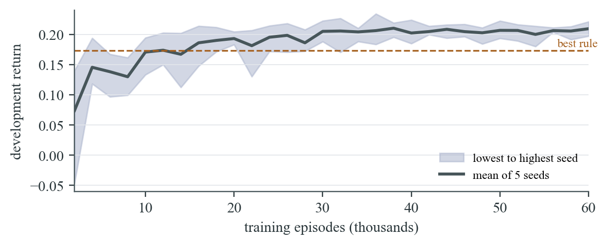
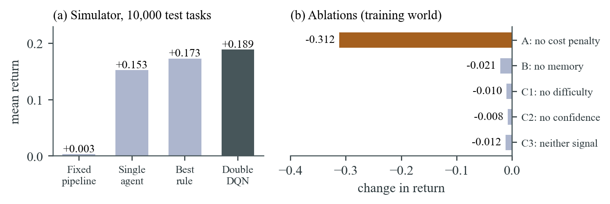
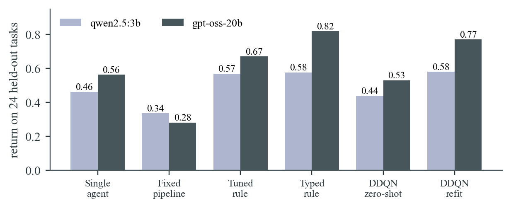
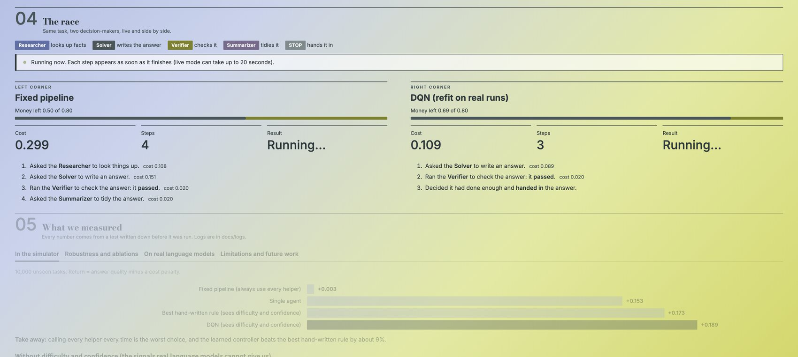
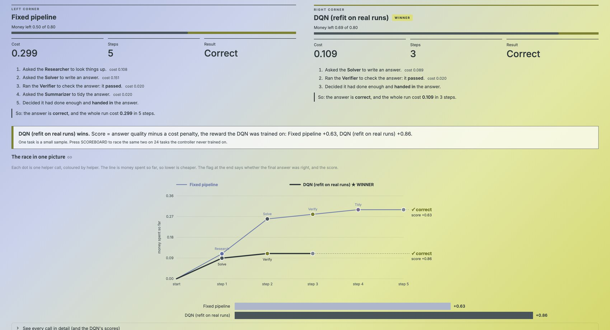
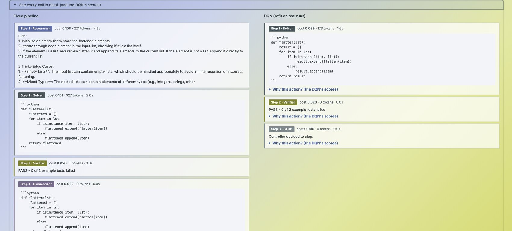

<div align="center">

# ORBIT

### Reinforcement Learning for Cost-Aware Orchestration of Multi-Agent LLM Systems

A Double Deep Q-Network controller that decides which LLM agent to call next, or when to stop,
evaluated in a simulator and on recorded runs of real language models.


**UCS760 Lab Evaluation · Thapar Institute of Engineering and Technology**

[Report (PDF)](report/ORBIT_Report.pdf) · [Results](#results) · [Run it](#quick-start) · [Dashboard](#interactive-dashboard)

</div>

<p align="center"></p>

---

## The problem

A multi-agent LLM system has several helpers: a **researcher** that looks things up, a **solver** that drafts
an answer, a **verifier** that checks it and a **summarizer** that cleans it up. Calling all of them on every
task is slow and expensive. Calling too few gives wrong answers. Fixed pipelines and hand-written rules pick
one trade-off and keep it for every task.

ORBIT treats each call as a decision. A controller looks at the current state of the task and chooses the
next agent, or decides to stop, under a cost budget. It learns that policy from reward.

<p align="center"></p>

## Formulation

| | |
|---|---|
| **State** (16 numbers) | task type, difficulty estimate, whether an answer exists, last verifier result, calls per agent, money and steps left, answer confidence, summarized flag |
| **Actions** (6, masked) | `INVOKE_RESEARCHER`, `INVOKE_SOLVER`, `INVOKE_VERIFIER`, `INVOKE_SUMMARIZER`, `RETRY_SOLVER`, `STOP` |
| **Reward** | R = q · 1[correct] − λ · C / C<sub>ref</sub> − 0.3 · 1[no answer], with λ = 0.5, C<sub>ref</sub> = 0.4 |
| **Learner** | Double DQN, MLP 16 → 128 → 128 → 6, action masking, experience replay, target network, 5 seeds |

The reward design was checked against four loophole tests before any training (stopping at once, useless
repeat calls, wasted calls after a correct answer, running out of budget). See [`docs/SPEC.md`](docs/SPEC.md).

## Results

All hypotheses and pass/fail thresholds were written down **before** each experiment
([`docs/SPEC.md`](docs/SPEC.md), [`docs/REAL_LLM_DESIGN.md`](docs/REAL_LLM_DESIGN.md)). Results that went
against the hypothesis are reported as they came out.

### Simulator (10,000 test tasks)

| Method | Return | Success | Cost | Steps |
|---|---:|---:|---:|---:|
| Fixed pipeline | +0.003 | 0.37 | 0.293 | 5.0 |
| Single agent | +0.153 | 0.34 | 0.123 | 2.0 |
| Best hand-written rule (uses difficulty and confidence) | +0.173 | 0.46 | 0.233 | 4.0 |
| **Double DQN (5 seeds)** | **+0.189** | **0.47** | **0.215** | **3.7** |

* **+9.3 %** return over the best rule, on every one of the five seeds, with lower cost.
* **+15.7 %** over the rule when both are *blind* to difficulty and confidence.
* At or above a rule retuned by hand for the shift in **5 of 6 shifted worlds** (tight or loose budget, harder or easier tasks, research-heavy mix).
* Removing the cost penalty collapses return to **−0.31**: the controller then calls everything.

<p align="center">
  
  
</p>

### Real language models (24 held-out tasks, recorded traces)

50 tasks with checkable answers (coding with hidden unit tests, exact-answer word problems, and research
questions over fictional documents). Each agent call was recorded several times, so every policy replays the
same traces and differences come from the policy, not from sampling luck.

| Policy | qwen2.5:3b return | success | gpt-oss-20b return | success |
|---|---:|---:|---:|---:|
| Single agent | +0.462 | 0.59 | +0.563 | 0.71 |
| Fixed pipeline | +0.336 | 0.75 | +0.282 | 0.75 |
| Tuned rule | +0.569 | 0.72 | +0.670 | 0.83 |
| Typed rule (one rule per task type) | +0.576 | 0.76 | **+0.819** | **1.00** |
| DQN, simulator only (zero-shot) | +0.438 | 0.64 | +0.530 | 0.71 |
| **DQN, refit on traces** | **+0.580** | **0.77** | +0.770 | 0.96 |

<p align="center"></p>

**What this shows.** A controller trained only in the simulator does not transfer (sim-to-real gap). Refit on
real traces, the DQN beats the fixed pipeline and the single agent on both models, ties the best hand rule on
qwen2.5:3b (+0.005) and trails it on gpt-oss-20b (−0.048). On real models the value of learning is that it
finds a good routing rule automatically from reward. It does not beat a well-designed expert rule.

## Interactive dashboard

A Streamlit app races a baseline against the DQN on the same task, live with a local model or replayed from
the recorded traces, and shows every agent call, its cost and the final score.

<p align="center">
  
  
</p>
<p align="center"></p>

## Quick start

```bash
git clone <this-repo-url> orbit-rl-orchestration
cd orbit-rl-orchestration
python3 -m venv .venv && source .venv/bin/activate
pip install -r requirements.txt

PYTHONPATH=. python3 -m pytest -q tests
python3 -m streamlit run app/dashboard.py
```

The dashboard works fully offline in **Replay** mode, using the recorded traces in `runs/` and the trained
checkpoints in `checkpoints/`. For **Live** mode, install [Ollama](https://ollama.com), run
`ollama pull qwen2.5:3b`, then start everything with `./run_demo.sh`.

To use the Groq backend (gpt-oss-20b), put `GROQ_API_KEY=...` in a `.env` file. It is git-ignored.

## Reproducing the experiments

| Study | Command |
|---|---|
| Train one DQN | `python3 -m rl.train --seed 0` |
| Baselines in the simulator | `python3 -m eval.run_baselines` |
| DQN tuning, 5 seeds | `python3 -m eval.tune_dqn` |
| Distribution shift | `python3 -m eval.shift` |
| Ablations | `python3 -m eval.ablate` |
| Blind controller | `python3 -m eval.ablate_blind` |
| Real-model comparison | `python3 -m eval.real_eval runs/cache_qwen3b.jsonl` |
| Typed-rule comparison | `python3 -m eval.real_eval_typed runs/cache_gptoss20b.jsonl` |
| Record new traces | `python3 -m llm.build_cache ollama qwen2.5:3b runs/cache_qwen3b.jsonl` |

The logs from the runs reported above are in [`docs/logs/`](docs/logs).

## Repository layout

```
env/          simulator: tasks, hidden agent behaviour, Gym-style environment
baselines/    single agent, fixed pipeline, hand-written rules
rl/           Double DQN, replay buffer, training loop
eval/         evaluation runner, tuning, shift, ablation, blind and real-trace studies
llm/          model client (Ollama, Groq), agents, 50 graded tasks, trace cache, replay environment
app/          race engine, charts and the Streamlit dashboard
tests/        87 tests: reward loopholes, environment, engine, tasks, dashboard
runs/         recorded real-model traces (qwen2.5:3b, gpt-oss-20b)
checkpoints/  trained controllers
report/       technical report and the scripts that build its figures
docs/         pre-registered design documents and run logs
```

## Limitations

* The real-model study uses 50 tasks and 24 held-out tasks, so intervals are wide.
* A cached retry does not see the verifier's feedback, which a live retry would.
* Cost is a token-based unit, not a provider bill.
* An LLM-as-router baseline is not included yet.

## Author

**Aditi Sikarwar** · B.E. Electronics and Communication Engineering, Thapar Institute of Engineering and Technology
